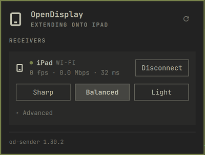

# OpenDisplay for Omarchy

An Omarchy bar widget around the official [OpenDisplay](https://github.com/peetzweg/opendisplay) Linux sender, `od-sender`. Extend your desktop onto an iPad, iPhone, Android device or Mac: discover receivers, connect in one click, pick a quality preset, and keep `od-sender` installed and up to date from its GitHub releases.

It does not reimplement the OpenDisplay protocol. Everything goes through the `od-sender` CLI.



## Install

```bash
omarchy plugin add https://github.com/muneebabbas/omarchy-opendisplay --enable
```

Install the OpenDisplay app on the device you want to extend onto and keep it in the foreground. If `od-sender` isn't installed yet, the panel offers to install the official release for you.

## Use

- **Left-click** the tablet icon to open the panel: receivers on your network, live stats (fps · Mbps · latency) for connected ones, quality presets and Advanced settings.
- **Right-click** disconnects everything if something is connected; otherwise it connects the receiver you used most recently (matched by its id, never by name).
- **Middle-click** opens the panel and rescans.

Presets set the receiver's bitrate: **Sharp** 35 Mbps, **Balanced** 20 Mbps (od-sender's default), **Light** 8 Mbps. **Advanced** has per-receiver auto-connect, bitrate and scale, plus global max fps, encoder, cursor mode and Tailscale fallback. Every setting is written to od-sender's own config file, `~/.config/opendisplay/sender.toml`, so the CLI, the systemd units and the panel always agree. Your comments and any keys the panel doesn't manage are kept.

Display position, scale and rotation are handled by Omarchy's monitor panel, which remembers them per display (`od-xxxxxx`). Move windows with Hyprland's usual monitor keybindings.

Sessions run as systemd user units, so they survive shell restarts and plugin reloads.

### Settings

In the bar's widget settings:

- **Check GitHub daily for od-sender updates** (on by default)
- **Show the connected receiver's name in the bar** (on by default)

### Keyboard and IPC

The panel works with the keyboard: arrows move, Enter activates, Esc closes, and Tab switches to the neighbouring panel.

Bind your own keys with `omarchy-shell`:

```bash
omarchy-shell io.github.muneebabbas.opendisplay toggle
omarchy-shell io.github.muneebabbas.opendisplay connect iPad        # by name (if unique) or id
omarchy-shell io.github.muneebabbas.opendisplay disconnect iPad
omarchy-shell io.github.muneebabbas.opendisplay disconnectAll
omarchy-shell io.github.muneebabbas.opendisplay rescan
omarchy-shell io.github.muneebabbas.opendisplay status
```

`connect <name>` only connects by name when exactly one receiver has that name; otherwise it answers `ambiguous: use the id`.

## What this plugin does on your system

**Commands it runs.** All of them go through `bin/omarchy-opendisplay`, with arguments passed as separate values, never as a shell string:

| Command | When |
|---|---|
| `od-sender --version`, `od-sender list --json --timeout 3`, `od-sender doctor` | Version check; discovery when the panel is open (on open, Rescan, and every 20 s); validating config changes |
| `systemd-run --user --unit=opendisplay-<id8> … od-sender run --to=<id>` | Connect |
| `systemctl --user stop/restart/enable/disable/show/list-units/reset-failed` on `opendisplay-*` and `od-sender@*` units | Disconnect, apply settings, auto-connect, status (every 5 s while connected, every 30 s otherwise) |
| `journalctl --user -u <unit> -o cat -f` | Live stats while a session runs |
| `kill -INT` / `kill -TERM` on an `od-sender` PID from its lock file | Disconnecting a sender you started outside the panel |
| `python3 -I bin/sender-config.py`, `python3 -I bin/opendisplay-util.py` | Reading and editing `sender.toml`; status, release and archive checks (stdlib only) |
| `curl`, `sha256sum`, `tar`, then the release's own `install.sh` | Only when you click Install or Update |
| `notify-send`, `xdg-terminal-exec`, `omarchy-launch-browser`, `pacman -Qo` | Notifications, the Doctor and Details terminals, the release page, detecting a pacman-installed od-sender |

No `sudo` or `pkexec`, ever.

**Hosts it contacts.** Only `api.github.com`, `github.com` and `objects.githubusercontent.com`, over HTTPS (redirects must stay on HTTPS; 60 s timeout; release JSON capped at 1 MB and downloads at 50 MB):

- Once a day (and when you open the panel, if the last check was over 6 hours ago) it asks `api.github.com` for the latest od-sender release, with an ETag so unchanged answers are cheap. The check is shared: every bar on every monitor reuses a cached answer younger than 6 hours, so GitHub is asked at most about once every 6 hours. Turn **Check GitHub daily for od-sender updates** off to stop this. With od-sender not installed, opening the panel also fetches the release so it can offer to install it.
- When you click Install or Update it downloads the release tarball and its `.sha256` file from GitHub.

**Files it writes.** `~/.config/opendisplay/sender.toml` (plus `sender.toml.bak`), od-sender's files via the official `install.sh` (`~/.local/bin/od-sender`, `~/.local/share/applications/od-sender.desktop`, `~/.config/systemd/user/od-sender@.service`), enabled auto-connect units under `~/.config/systemd/user/`, a cache in `~/.cache/omarchy-opendisplay/`, lock files in `$XDG_RUNTIME_DIR/omarchy-opendisplay/`, and a list of up to 16 recently used receivers (id, name, last address, time) in this widget's entry in `~/.config/omarchy/shell.json`.

## Security notes

- **Downloads are checksum-verified, not signed.** An install or update only runs after the tarball's SHA-256 matches both the release's `.sha256` file and the digest GitHub's API reports for that asset; it aborts if either is missing or different. The archive is also checked for absolute paths, `..`, links and device files before it's unpacked. This proves the file is the one GitHub published for that release. It isn't a signature, because upstream doesn't sign releases, so you are trusting the peetzweg/opendisplay GitHub account. Updates never install by themselves; you always click.
- **OpenDisplay is plain TCP with no encryption or pairing.** Anyone on the network path can see the stream, and any receiver that answers can be connected to. Use it on networks you trust, or over Tailscale.
- Receiver names, log lines and release data are treated as untrusted. They're length-limited and always shown as plain text.
- Auto-connect is off by default and only turned on by you, per receiver. It's LAN-only: `od-sender run --wait` doesn't try Tailscale peers.

## Remove

```bash
omarchy plugin remove io.github.muneebabbas.opendisplay
```

The plugin never uninstalls od-sender. To remove od-sender too, disable any auto-connect units (`systemctl --user disable --now 'od-sender@*'`), then run the uninstaller from the release tarball (`./install.sh --uninstall`) or delete `~/.local/bin/od-sender`, `~/.local/share/applications/od-sender.desktop` and `~/.config/systemd/user/od-sender@.service`. Your settings stay in `~/.config/opendisplay/`.

## Development

There's no build step and nothing to install into the repo: the plugin is plain QML, JavaScript, bash and stdlib-only Python, loaded by the shell straight from its folder.

### Dependencies

To run the plugin (all present on a stock Omarchy install): the Omarchy shell, bash 4+, python3 3.11+ (for `tomllib`), systemd user services (`systemctl`, `systemd-run`, `journalctl`, `systemd-escape`), coreutils, util-linux (`flock`), `tar`, `curl`, `notify-send` and `xdg-terminal-exec`.

To run the tests, add Node.js 20+ and `jq`. The tests never touch your real session: `tests/helper.sh` runs the helper against a fake `od-sender`, fake `systemctl`/`systemd-run`/`notify-send`, a temporary `HOME` and no network.

For the full check (what CI runs), these are also used when available:

| Tool | Used for | Arch package |
|---|---|---|
| `uv` | Runs pinned `shellcheck` and `ruff` with `uvx`, nothing installed globally | `uv` |
| `shellcheck`, `ruff` | Fallbacks when `uv` isn't installed | `shellcheck`, `ruff` |
| Qt 6 `qmlformat` | Parse check for the QML files (`/usr/lib/qt6/bin/qmlformat`) | `qt6-declarative` |
| `omarchy plugin validate` | Manifest validation; without Omarchy, the same validator is downloaded from omacom/omarchy at a pinned commit and checksum | — |

```bash
sudo pacman -S --needed nodejs jq uv qt6-declarative
```

### Checks

```bash
bash tests/check.sh               # everything CI runs
bash tests/check.sh --tests-only  # just the two test suites
node tests/run.js                 # Model.js: parsing, validation, merge logic, plain-text sinks
bash tests/helper.sh              # bin/: install, config editing, unit names, status
```

Locally, a missing linter is skipped with a notice; in CI (`CI=true`) it fails the run. A full `qmllint` isn't possible outside a running shell, because the QML imports the shell's own modules (`qs.Commons`, `qs.Ui`, Quickshell), so CI only parses the QML.

CI (`.github/workflows/ci.yml`) runs on every push to `main` and every pull request:

- **Arch Linux container:** the full `tests/check.sh` as a normal user, with the same Qt 6, bash and coreutils as Omarchy.
- **Ubuntu with Python 3.11 and Node 20:** the test suites on the oldest supported runtimes.

### Helper exit codes

The helper's exit codes are part of its contract with the widget (for example 2 for an invalid argument, 8 when od-sender isn't installed, 11 when GitHub can't be reached). Run `bin/omarchy-opendisplay help` for the full list.

### Trying changes in the shell

Copy the working tree into the plugin folder, then restart the shell:

```bash
rsync -a --delete --exclude .git --exclude docs --exclude tests ./ ~/.config/omarchy/plugins/io.github.muneebabbas.opendisplay/
omarchy restart shell
omarchy plugin enable io.github.muneebabbas.opendisplay   # first time only
```

- Use a copy, not a symlink to the repo. A symlinked folder loads, but the shell doesn't pick up edits made through it.
- On the shell tested (Hyprland 0.57, Omarchy Quattro), saved edits to a running plugin weren't applied by the automatic reload or by `omarchy-shell shell reloadPlugins`. Restart the shell after each change.
- Sessions run in systemd, so a connected display survives the restart.
- Shell log: `journalctl --user -t omarchy-shell -f`.

The helper also works on its own, which is handy for debugging: `bin/omarchy-opendisplay status`, `list`, `version`, `check-update`, `config-get` and so on (`bin/omarchy-opendisplay help`). For acceptance testing an update, `OMARCHY_OPENDISPLAY_RELEASE_FILE=<release.json>` points `check-update` and `install` at a local release object instead of GitHub.

`docs/SPEC.md` is the design spec, including the manual acceptance tests.

## Credits

OpenDisplay and `od-sender` are by [peetzweg](https://github.com/peetzweg/opendisplay). This plugin only drives the official sender.

MIT licensed.
