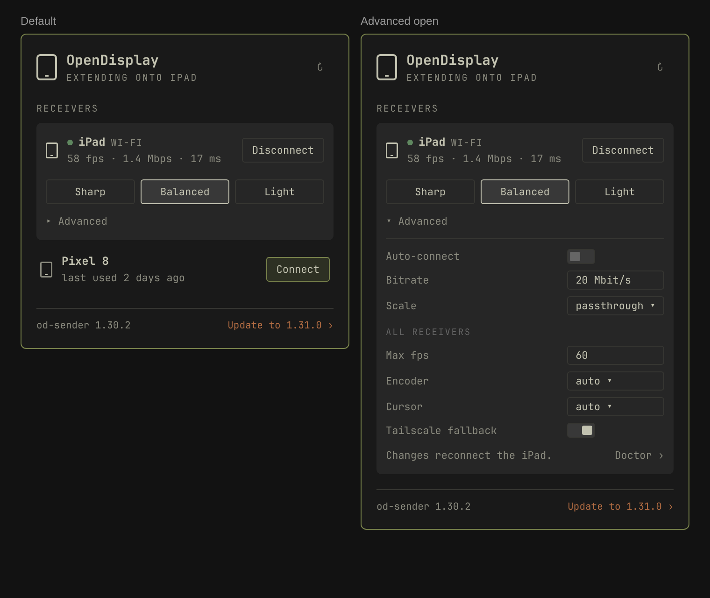

# OpenDisplay for Omarchy: implementation spec

Status: approved design, ready to build (2026-11-09).
Repo: https://github.com/muneebabbas/omarchy-opendisplay · Plugin ID: `io.github.muneebabbas.opendisplay`

This document is meant to be enough for an agent to build the plugin end to end without further context. Everything marked **verified** was observed on the target machine (Omarchy Quattro, Hyprland 0.57.0, od-sender 1.30.2, iPad receiver over Wi-Fi). Everything marked **verify during build** is an assumption the builder must check before relying on it.



`docs/design.html` is the source of the screenshot (open it in a browser). Colors there are the Miasma theme; the real plugin must take every color and font from the Omarchy theme (`Commons.Color`, `bar.foreground`, `Style.font`), never hard-coded.

---

## 1. What it is

An Omarchy shell **bar widget** that wraps the official OpenDisplay Linux sender, `od-sender` (https://github.com/peetzweg/opendisplay). It:

1. Installs `od-sender` if it's missing, and keeps it updated from GitHub releases (checksum-verified, user-confirmed).
2. Lists OpenDisplay receivers on the network (iPad, iPhone, Android, Mac) and connects or disconnects with one click.
3. Shows live stream stats for a connected receiver: fps, Mbps, end-to-end latency, transport.
4. Offers quality presets (Sharp / Balanced / Light) and an **Advanced** section exposing the options od-sender reads from its config file.
5. Optionally auto-connects a receiver whenever it appears (systemd user unit).

### Non-goals (decided)

- **No protocol reimplementation.** Everything goes through the `od-sender` CLI. Existing plugins (`Unayung/omarchy-ipad-sidecar-x86`, `LeoAba/omarchy-sidecar-leoaba`) reimplement the protocol in Python; this plugin deliberately doesn't.
- **No display positioning or window moving.** Omarchy's monitor panel already saves position, scale and rotation per monitor. **Verified:** a position saved via the monitor panel for `od-a0ec23` was re-applied on reconnect and won over od-sender's `auto-right`. Moving windows is done with Hyprland's native monitor keybindings.
- **No workspace pinning.** See §11, upstream bug 1: on Hyprland 0.57 a named workspace breaks od-sender.
- **No keyboard-shortcut hints printed in the panel.** Standard panel keyboard navigation (arrows, Enter, Esc, Tab to the neighbouring panel) still works through `PanelKeyCatcher`; it just isn't advertised in the UI.
- **No Hyprland config writing in v1.** Nothing needs it now that positioning and workspaces are out of scope.

---

## 2. od-sender contract (verified, v1.30.2)

Binary: `od-sender`, installed by default at `~/.local/bin/od-sender`. Always run it with `NO_COLOR=1`; otherwise logs contain ANSI escapes even when piped.

| Command | Use in plugin | Notes |
|---|---|---|
| `od-sender --version` | Installed version | Prints `od-sender 1.30.2`. Parse with `/^od-sender (\d+\.\d+\.\d+)/`. |
| `od-sender list --json --timeout 3` | Discovery | JSON array of `{name, addr, id, pv}`, e.g. `[{"name":"iPad","addr":"10.93.10.226:9000","id":"A0EC2343-F05E-4776-8903-8C62BB114896","pv":3}]`. Exit 0 with `[]` when nothing is found. Takes about `timeout` seconds. Also tries Tailscale peers when Bonjour finds nothing (about 1 s extra) unless `tailscale = false`. |
| `od-sender run --to <id\|name\|host:port> [--wait]` | The session | Runs in the foreground until stopped. Without `--wait` it gives up after 10 s with **exit 3** if the receiver isn't found. Reconnects on its own after Wi-Fi drops (unless `--no-reconnect`). SIGINT and SIGTERM disconnect cleanly and remove the virtual display. |
| `od-sender disconnect [name\|od-xxxxxx]` | Fallback stop | Signals the running sender. Prints `No running od-sender is connected to "X"` when it can't match; that happened with a stuck sender (§11), so never rely on it alone. |
| `od-sender doctor` | Health and config validation | Exit 0 = ok, **2 = unsupported desktop or sender.toml doesn't parse**, 1 = other error. Human-readable output; show it in a terminal (`omarchy launch terminal` / `xdg-terminal-exec`), don't parse it. |
| `od-sender clean` | Leftover displays | Removes virtual displays left by dead senders. Breaks on the named-workspace bug (§11). |

**Exit codes for `run`:** 0 done, 1 error, 2 unsupported desktop or bad config (don't retry), 3 no matching receiver, 4 several receivers and no `--to` (the plugin always passes `--to`, so treat 4 as a bug).

**Static screens:** od-sender only sends frames when the screen changes, so `sent 0.0 fps 0.0 Mbit/s` is normal for an idle desktop. It is **not** a stall; show the numbers as they are.

**Virtual display name:** `od-` + the first 6 hex characters of the receiver id, lowercased (`A0EC2343-…` → `od-a0ec23`). It's the same on every connection (**verified**, several runs). Omarchy records it as the monitor identity `od-a0ec23` in `~/.local/state/omarchy/monitors/workspaces`.

**Lock files:** `$XDG_RUNTIME_DIR/opendisplay/<output>.lock` holds the sender's PID. The file **stays behind after the sender exits** (**verified**), so a session is live only if the PID is alive **and** `/proc/<pid>/comm` is `od-sender`.

**Log lines to parse** (stderr, one per line, timestamp then level then message):

```
… INFO connected to receiver 10.93.10.226:9000
… INFO hello: 2388x1668 @120 scale 2 device Some("iPad") id Some("A0EC2343-…") pv 3
… INFO virtual display od-a0ec23 = 2388x1668 @120 scale 2 at 1440,0 (1194x834 logical)
… INFO Extending onto iPad (A0EC2343-…): 1194x834 logical at 2x (od-a0ec23, right of your other displays). Ctrl+C to stop.
… INFO encoder: x264 2388x1668 20.0 Mbit/s, 8 threads
… INFO sent 58.6 fps 1.4 Mbit/s | encode p50 8.7 ms p95 12.1 ms | capture->send p50 12.9 ms p95 18.3 ms | SenderCounters { … }
… INFO PHONE-STATS {"e2e50":17,"e2e95":24,"fps":58,"mbps":3.2,"rtt":5,"stalls":0,"transport":"WiFi", …}
… INFO removed virtual display od-a0ec23
… INFO connection ended
… ERROR no receiver matching "Nope"; on the network: …
… WARN Hyprland 0.57.0 is newer than the tested 0.56.x; …
```

- `sent X fps Y Mbit/s` comes every 5 s from the sender and drives **fps** and **Mbps**.
- `PHONE-STATS {json}` comes every ~5 s from the receiver and drives **latency** (`e2e50`, in ms) and **transport** (`WiFi` → "Wi-Fi", `USB` → "USB", anything else is shown as given, length-capped). Parse the JSON after the literal `PHONE-STATS `; ignore it if the parse fails.
- The `hello:` line gives the receiver's device name and id.
- Treat every log field as untrusted text (§9).

**Config file:** `$XDG_CONFIG_HOME/opendisplay/sender.toml` (default `~/.config/opendisplay/sender.toml`; absent on the target machine). Upstream format:

```toml
to = "iPhone"            # used when run gets no --to
position = "auto-right"
scale = "passthrough"    # "passthrough", "mac" or a number
bitrate-mbps = 20
max-fps = 60
encoder = "auto"         # "auto", "v4l2m2m", "x264" or "openh264"
cursor = "auto"          # "auto", "video" or "off"
capture = "auto"         # "auto", "ext" or "wlr"
workspace = "8"
tailscale = true

# Per-receiver overrides: ONLY position, scale, bitrate-mbps and workspace.
[receiver."3F2A9C1E-..."]
scale = 2
bitrate-mbps = 35
```

- A `[receiver."…"]` table matches on id (case-insensitive), then network name, then device name. **Always key tables by id.**
- Precedence: CLI flag > receiver table > top-level > built-in default.
- **Unknown keys or invalid values make `run` refuse to start** and `doctor` exit 2. Every write must be validated (§6).

**systemd template unit** (installed by the official `install.sh` at `~/.config/systemd/user/od-sender@.service`):

```ini
[Service]
ExecStart=/home/<user>/.local/bin/od-sender run --to %I --wait
Restart=on-failure
RestartSec=15
RestartPreventExitStatus=2
[Install]
WantedBy=graphical-session.target
```

The user systemd manager already has `WAYLAND_DISPLAY` and `HYPRLAND_INSTANCE_SIGNATURE` (uwsm exports them; **verified** with `systemctl --user show-environment`), so od-sender works under systemd.

**Releases (verified):** `https://api.github.com/repos/peetzweg/opendisplay/releases/latest` → `tag_name` `v1.30.2`. Assets include `od-sender-x86_64-unknown-linux-gnu.tar.gz` and `od-sender-aarch64-unknown-linux-gnu.tar.gz`, each with a `.sha256` sidecar (`<hex>  <filename>`). The API asset object also carries `"digest": "sha256:<hex>"`. Releases come every few days. The tarball unpacks to `od-sender-<arch>-unknown-linux-gnu/` containing `od-sender`, `install.sh`, `od-sender.desktop`, `od-sender@.service`, `LICENSE`, `PROTOCOL.md`, `THIRD-PARTY-LICENSES.txt`. `install.sh` (no args) installs for the current user into `~/.local/bin`, `~/.local/share/applications` and `~/.config/systemd/user`, then runs `systemctl --user daemon-reload`. It refuses to run as root without `--system`. There is no AUR package yet; upstream ships a PKGBUILD that installs to `/usr/bin/od-sender`.

---

## 3. Repository layout

```
manifest.json              # plugin manifest (schema below)
Panel.qml                  # entry point: bar button + KeyboardPanel UI
Service.qml                # state, Processes, timers; no UI
Model.js                   # .pragma library: pure parsing/validation, unit-tested
OpenDisplayIcon.qml        # tablet glyph used in the bar and the panel hero; states: idle / live / attention
i18n/en.json               # all user-visible strings (English only for v1)
bin/omarchy-opendisplay    # bash helper: install, update, session control, config edits
bin/sender-config.py       # python3 stdlib-only sender.toml reader/writer, called by the helper
bin/opendisplay-util.py    # python3 stdlib-only status/release/tarball helpers
bin/usbmux.py              # python3 stdlib-only USB transport through usbmuxd (§4a)
tests/run.js               # node tests for Model.js (pattern: yeleticc.vpn/tests/run.js)
tests/helper.sh            # bash tests for bin/ against a fake od-sender and a temp HOME
tests/fixtures/            # captured od-sender outputs (list --json, log lines, release JSON)
docs/SPEC.md, docs/design.png, docs/design.html
preview.png                # marketplace preview: real screenshot of the panel, ~400px wide
README.md                  # install, use, uninstall, security notes, upstream credit
LICENSE                    # MIT (exists)
```

Reference implementations to read before starting (read-only, never edit):
- `/usr/share/omarchy/shell/plugins/panels/tailscale/` (`Panel.qml`, `Service.qml`, `Model.js`, `manifest.json`): the closest first-party analogue (status, list of peers, toggles, `Process` + `StdioCollector`, `ShellIpc`, `KeyboardPanel`, `PanelHero`, `ToggleSwitch`, inline settings persistence through `bar.shell.updateEntryInline`).
- `/usr/share/omarchy/shell/Ui/`: the UI kit (`Panel`, `KeyboardPanel`, `PanelKeyCatcher`, `BarIconButton`, `PanelHero`, `PanelSectionHeader`, `PanelSeparator`, `Button`, `ButtonGroup`, `ToggleSwitch`, `Dropdown`, `NumberField`, `TextField`, `PanelToolTip`, `ConfirmDialog`). Use these, don't hand-roll widgets.
- `~/.config/omarchy/plugins/yeleticc.vpn/`: a third-party plugin with `Model.js` unit tests and helper scripts.
- `~/.claude/skills/omarchy/plugins.md`: plugin rules for text safety, motion and translations. Follow them.

### manifest.json

```json
{
  "schemaVersion": 1,
  "id": "io.github.muneebabbas.opendisplay",
  "name": "OpenDisplay",
  "version": "0.1.0",
  "author": "Muneeb Abbas",
  "license": "MIT",
  "description": "Extend your Omarchy desktop onto an iPad, phone or Mac with the official OpenDisplay sender (od-sender): discover receivers, connect in one click, pick a quality, and keep od-sender up to date.",
  "kinds": ["bar-widget"],
  "entryPoints": { "barWidget": "Panel.qml" },
  "barWidget": {
    "displayName": "OpenDisplay",
    "description": "Left-click for receivers and quality; right-click to connect the last receiver or disconnect; middle-click to rescan.",
    "category": "Display",
    "allowMultiple": false,
    "defaultSection": "right",
    "defaults": { "checkUpdates": true },
    "schema": [
      { "key": "checkUpdates", "type": "boolean", "label": "Check GitHub daily for od-sender updates", "defaultValue": true }
    ]
  }
}
```

Run `omarchy plugin validate ~/projects/omarchy-opendisplay` after every manifest change. The plugin also stores private state in its inline `shell.json` entry through `bar.shell.updateEntryInline` (as tailscale's `persistRecentMullvad` does). That state is `knownReceivers`: a list of up to 16 `{id, name, lastAddr, lastUsed}`, used for "last used …" and right-click "connect last". It isn't part of `schema`.

---

## 4. Session management (systemd)

Sessions run **outside the shell process**, so they survive shell restarts and plugin hot-reloads (saving any file under `~/.config/omarchy/plugins/` reloads the plugin).

**Unit names (one rule, never hand-built):**
- Template (auto-connect): `od-sender@$(systemd-escape -- "$id").service`. For id `A0EC2343-F05E-4776-8903-8C62BB114896` that is literally `od-sender@A0EC2343\x2dF05E\x2d4776\x2d8903\x2d8C62BB114896.service` (**verified** with `systemd-escape`). Always build it with that function, and always use the uppercase id exactly as `list --json` returns it.
- Transient (manual connect): `opendisplay-<id8>.service`, with `<id8>` = the first 8 characters of the id, lowercased (they're hex). For Connect by IP: `opendisplay-addr-<sha1 of host:port, first 8 hex>.service`. Over USB: `opendisplay-usb-<id8>.service` (§4a).
- The helper has one function per name and every subcommand goes through it. Tests assert both names for the fixture id.

**Verified on the target machine:** `systemd-run --user --unit=opendisplay-a0ec2343 --setenv=NO_COLOR=1 --property=Restart=no -- ~/.local/bin/od-sender run --to <id>` connects. `journalctl --user -u <unit> -o cat` shows the log lines from §2 with their timestamp and level. `/proc/<pid>/cgroup` ends in `/app.slice/opendisplay-a0ec2343.service`. A unit started with `--to Nope` ends with `ActiveState=failed`, `Result=exit-code`, `ExecMainStatus=3`, and `systemctl --user reset-failed` clears it.

All of the following are implemented in `bin/omarchy-opendisplay` and called from QML with argument arrays (never a shell string):

| Helper subcommand | Does |
|---|---|
| `connect <id>` | `systemd-run --user --unit=opendisplay-<id8> --description="OpenDisplay to <id>" --setenv=NO_COLOR=1 --property=Restart=no -- <od-sender path> run --to=<id>`. Always use the `--to=<value>` form so a value can never be read as a flag. Do **not** pass `--collect`: it unloads a failed unit, and the exit code (`ExecMainStatus`) is needed afterwards. `<id8>` = the first 8 hex characters of the id, lowercased. Before starting, if `od-sender@<escaped id>.service` is active, do nothing (it's already connected). If a transient unit by that name exists in failed state, `systemctl --user reset-failed` it first. |
| `connect-usb <id>` | §4a. Finds the plugged-in device whose receiver has that id (`usbmux.py find`), then `systemd-run --user --unit=opendisplay-usb-<id8> --description="OpenDisplay to <id>" --setenv=NO_COLOR=1 --property=Restart=no -- python3 -I bin/usbmux.py run --udid=<udid> --sender=<od-sender path>`. No-op if a USB, Wi-Fi or external session for the id is live. Stops (doesn't disable) a running auto-connect template for the id, only once the device is found on USB, right before `systemd-run`. The unit has `KillMode=mixed`. Exit 13 without usbmuxd, 14 when the receiver isn't on USB. Works with Wi-Fi connections off. |
| `usb-list` | `usbmux.py list`: `[{udid, deviceId, id, name, pv}]`; `[]` when usbmuxd isn't running. |
| `wifi on\|off\|status` | §4b. |
| `connect-addr <host:port>` | Same, with `--to=<host:port>`, for "Connect by IP". Validate against `^[A-Za-z0-9\[][A-Za-z0-9.\-:\[\]]{0,79}:[0-9]{1,5}$` (no leading `-`, port 1–65535). The receiver's real id is learned from the `hello:` log line and stored in session state, so the card, presets and disconnect work by id from then on. |
| `disconnect <id\|unit>` | Accepts a receiver id or a unit name (for a Connect-by-IP session whose `hello` hasn't arrived yet). `systemctl --user stop opendisplay-<id8>.service opendisplay-usb-<id8>.service od-sender@<esc>.service` (ignore "not loaded"). If a live lock-file PID for `od-<id6>` remains after 3 s (a sender started outside the plugin), send it SIGINT, then SIGTERM after 3 more seconds. Don't call `od-sender disconnect` first; it misses stuck senders (§11). |
| `restart <id>` | Used after a settings change: `systemctl --user restart` whichever unit is active (template, then USB, then Wi-Fi transient). For an external sender: disconnect, then connect. |
| `autoconnect <id> on\|off` | `systemctl --user enable --now 'od-sender@<esc>.service'` / `disable --now`. `<esc>` = `systemd-escape -- <id>`. If a transient session for that id is running, stop it first so two senders don't fight. Auto-connect is **off by default** and only ever turned on by the user, per receiver. It is **LAN-only**: `run --wait` doesn't try Tailscale peers (upstream README), so the toggle's tooltip says "Connects automatically when this device is on the local network". Requires the template unit; if it's missing (pacman install with no user unit), report "Auto-connect needs the od-sender systemd unit" and leave the toggle off. |
| `status --json` | Prints one JSON object with every session: for each lock file with a live `od-sender` PID, `{output, pid, unit (the owning unit name or null for external), id (from the cmdline `--to=`/`--to` value when it's an id; otherwise null until the Service learns it from the `hello:` log line), since}`, plus `units` for any `opendisplay-*` / `od-sender@*` units that are activating or active (no lock yet = "connecting"). The unit that owns a PID comes from `/proc/<pid>/cgroup`. A USB session's `id` comes from its unit's Description (its sender runs with `--to=127.0.0.1:<port>`). Every session and unit has `transport`: `usb` (an `opendisplay-usb-*` unit), `tailscale` (a `100.64.0.0/10` address) or `wifi`. Top level also has `wifi` (bool, §4b) and `usb` (`running` \| `installed` \| `missing`, usbmuxd). |
| `logs <unit>` | `exec journalctl --user -u <unit> -o cat -f -n 0 --since=<unit ActiveEnterTimestamp>`, so old lines from an earlier run of the same unit are never replayed. State is seeded from `status --json`, not from the log. The Service runs this as a long-lived Process with `SplitParser` and feeds lines to `Model.parseLogLine`. |
| `install` / `update` / `check-update` / `version` | §5 |
| `config-get` / `config-set` | §6 |
| `doctor` | Opens a terminal running `od-sender doctor; read -n1 -p 'Press any key'`. |

Rules:
- **Multiple simultaneous receivers are supported** (od-sender allows one sender per receiver). The UI shows each connected receiver as an expanded card.
- **Start order:** run `od-sender list` first so a connect always targets a known `id`, except Connect by IP.
- **State refresh:** `status --json` on panel open, after every action (debounced 300 ms), and every 5 s while any session is active or connecting. Every 30 s otherwise, which is cheap: no network. Discovery (`list`) runs only on panel open, Rescan, middle-click, and once every 20 s while the panel is open. Never run discovery in the background while the panel is closed.
- **Connecting state:** after `connect`, show "Connecting…" on that row until a `connected to receiver` or `Extending onto` log line arrives. If the unit exits first, map its exit code with `systemctl --user show -p ExecMainStatus`: 3 → "Not found on the network; open the OpenDisplay app on the device"; 2 → "od-sender can't run here or sender.toml is invalid · Doctor"; other → the last `ERROR` log line, truncated to 160 characters.
- **Lost connection:** od-sender reconnects by itself. If **no log lines at all** arrive for more than 15 s while the unit is active (both `sent` and `PHONE-STATS` normally come every ~5 s, even at 0 fps), show the row as "Reconnecting…" with a dim dot. Don't kill it. Zero fps alone isn't a lost connection (§2).
- **Shell restart:** on load, `status --json` rebuilds state from systemd and lock files. Nothing is kept in memory alone.

### 4a. USB (verified 2026-11-09, iPad over a cable, usbmuxd 1.1.1)

od-sender has no USB transport on Linux; the plugin adds one without touching the OpenDisplay protocol.

- **usbmuxd** (`sudo pacman -S usbmuxd`; udev starts it when an Apple device is plugged in) exposes a unix socket, `/var/run/usbmuxd`, or `$USBMUXD_SOCKET_ADDRESS` (`UNIX:/path` or `host:port`, as libusbmuxd). Messages are a 16-byte little-endian header (length, version 1, type 8 = plist, tag) plus an XML plist. `ListDevices` lists devices (only `ConnectionType` `USB` is used; Wi-Fi-paired `Network` entries are ignored). `Connect` with `DeviceID` and `PortNumber` = `htons(9000)` answers `Result` with `Number` 0, after which the socket is a raw byte pipe to TCP 9000 on the device, where the receiver listens. `Listen` streams `Attached` / `Detached` events. Reference: upstream `src/Mac/Usbmux.swift`.
- **Which receiver is on which device:** connect to 9000 and read the receiver's first message, a 4-byte big-endian length plus JSON hello (`id`, `device`, `pv`), then close without sending anything. The receiver drops a client that never speaks; a running session isn't disturbed. Results are cached per `UDID#DeviceID` in `$XDG_RUNTIME_DIR/omarchy-opendisplay/usb-cache.json` (DeviceID changes on every replug and usbmuxd restart); failed probes (app not open) aren't cached.
- **Session:** one transient unit, `opendisplay-usb-<id8>.service`, whose main process is `usbmux.py run`. It binds `127.0.0.1:0` (the kernel picks a free port, so there is no race), starts `od-sender run --to=127.0.0.1:<port>` as its child (same cgroup: the lock file, `status`, log tails and `systemctl stop` work as for any other session), forwards every connection on that port that comes from its own od-sender (checked via `/proc/net/tcp` inode → `/proc/<child>/fd`) through a fresh usbmuxd `Connect`, and SIGINTs od-sender when the device is unplugged (or usbmuxd goes away), escalating to SIGTERM after 5 s and SIGKILL after 3 more. The unit has `KillMode=mixed`, so `systemctl stop` signals only usbmux.py, which runs that same sequence; a requested stop exits 0, so the unit isn't left failed. It exits with od-sender's exit code (3 if the device isn't there at start), so the connect error mapping in §4 still applies. One unit instead of a forwarder unit bound to a sender unit: nothing to keep in step on stop, restart, failure or update.
- Only TCP 9000 is used. The receiver's UDP cursor port must not be used over USB (upstream PROTOCOL §6.3); od-sender falls back to the TCP cursor by itself when UDP gets no ack, so `cursor` is left as configured.
- **Verified:** `connect-usb` → journal shows `connected to receiver 127.0.0.1:<port>`, `Extending onto iPad`, and `PHONE-STATS … "transport":"USB"`; `restart` and `disconnect` work; no processes are left behind.
- **UI:** `usb-list` runs with discovery (panel open, Rescan, every 20 s while open). `Model.mergeReceivers(…, usb)` merges it with `list` by id: a row on both is one row with a **USB** tag; a USB-only row is listed too. `Model.connectRoute(id, usb, wifiEnabled)` picks `connect-usb` when the receiver is on USB, else `connect` when Wi-Fi is allowed. Cards, hero and bar tooltip name the link with `Model.linkLabel(via, phoneTransport)`: USB / Tailscale from status, else the receiver's PHONE-STATS transport, else Wi-Fi. The loopback address isn't stored as a known receiver's `lastAddr`. When usbmuxd is `missing`, the panel shows "USB needs usbmuxd: sudo pacman -S usbmuxd", only when Wi-Fi connections are off or nothing was found; Doctor reports usbmuxd too.
- **Out of scope:** USB auto-connect (auto-connect stays the upstream Wi-Fi template); Android over USB.

### 4b. Wi-Fi connections switch

A global switch in Advanced → All receivers, on by default. Its only state is the flag file `$XDG_CONFIG_HOME/omarchy-opendisplay/wifi-disabled` (present = off), read by the helper (`wifi status`, `status --json` → `wifi`) and by the drop-in below.

- `wifi off`: write the flag; write `~/.config/systemd/user/od-sender@.service.d/omarchy-opendisplay-wifi.conf` with `ExecCondition=test ! -e "<flag>"` and `daemon-reload` (enabled auto-connect units stay enabled, but every start is skipped cleanly, not failed, so `Restart=` doesn't loop; **verified**: "Skipped due to 'exec-condition'"); stop every running non-USB session unit (`opendisplay-util.py wifi-units`: templates, `opendisplay-<id8>`, `opendisplay-addr-*`). USB sessions and external senders keep running. `wifi on` skips auto-connect units whose receiver is already connected (USB unit, Wi-Fi unit or live lock).
- `wifi on`: remove the flag and the drop-in, `daemon-reload`, start the enabled auto-connect units.
- While off: `list` prints `[]` without running od-sender; `connect` and `connect-addr` exit **12** ("Wi-Fi connections are turned off"), as does `restart` of anything but a USB unit; the check sits in the one function that starts network units, so a restore after an update can't connect over Wi-Fi either. The UI doesn't run `list`, hides Connect by IP and Tailscale fallback, says "Wi-Fi connections are off. Plug in your iPad or iPhone by USB…" when nothing is found and offers **Turn on Wi-Fi** there (otherwise the switch would be unreachable with no receiver rows). Right-click "connect last" runs `usb-list` first and connects only over USB. IPC: `wifi on|off|status`.

---

## 5. Install and update

Helper subcommands; all network access goes to fixed HTTPS hosts (`api.github.com`, `github.com`, `objects.githubusercontent.com`) with `curl --proto =https --proto-redir =https --tlsv1.2 -fsSL --max-time 60 --max-filesize 50M`.

- **`version`:** `od-sender --version` → `{installed, version, path, managed}`. `managed` is `"user"` if the path is under `$HOME/.local/bin`, `"package"` if `pacman -Qo <path>` succeeds, otherwise `"other"`.
- **`check-update`:** GET `releases/latest` (send `If-None-Match` with a cached ETag from `$XDG_CACHE_HOME/omarchy-opendisplay/release.json` to save rate limit). Pick the asset `od-sender-$(uname -m)-unknown-linux-gnu.tar.gz` (`x86_64` or `aarch64`; anything else → "unsupported architecture"). Output `{latest, url, digest, sha256Url, htmlUrl, newer: bool}`. Compare numerically on `major.minor.patch` after stripping `v`. Skip drafts and prereleases (`/latest` already does).
- **`install` / `update`:**
  1. Refuse if `managed == "package"`: print "od-sender is installed by pacman; update it with your package manager". The UI then shows the update as information only, with a link to the release page.
  2. `mktemp -d` under `$XDG_CACHE_HOME/omarchy-opendisplay/`, downloading the tarball and the `.sha256` file there.
  3. Verify `sha256sum` matches **both** the `.sha256` file and the API `digest`. Abort on any mismatch, **or if either is missing**, before extracting.
  4. List the archive with `tar -tvzf` first and reject it if any entry has an absolute path, a `..` component, or is anything but a regular file or directory (no symlinks, hardlinks or devices). Expect exactly one top-level directory `od-sender-<arch>-unknown-linux-gnu/` containing `od-sender` and `install.sh`. Then `tar -xzf --no-same-owner --no-same-permissions`.
  5. Record which receivers are connected (`status --json`; USB units are restored with a fresh `connect-usb`). If any **external** sender (one not owned by a plugin unit) is live, refuse with "Stop the od-sender running in your terminal first". Otherwise stop all plugin-managed and template units, then run `<dir>/install.sh` (no args, never as root).
  6. Restart the units that were running. `daemon-reload` is done by `install.sh`.
  7. Verify `od-sender --version` now reports the new version; print the result. Delete the temp directory.
- **When the UI checks:** on shell start (after 60 s), every 24 h, and on panel open if the last check was more than 6 h ago, all only when `checkUpdates` is true. The README must say the plugin contacts api.github.com once a day and how to turn that off.
- **Never auto-install.** The user clicks "Update to X ›" in the footer (or "Install od-sender" on first run). If any receiver is connected, show a `ConfirmDialog` with `selectedIndex: 0` so Enter cancels: "Updating restarts od-sender. iPad will reconnect in a few seconds."
- **Progress:** the footer link changes to "Updating…" with a spinner, then "Updated to X" for 4 s. Errors show in the footer in the urgent color, with "Details" opening the helper's output in a terminal.
- **Not installed:** the panel body is replaced by the first-run card (§7). After install it goes straight to discovery.

---

## 6. Quality presets and Advanced (sender.toml)

The plugin edits `sender.toml` so the CLI, the systemd units and the plugin all agree.

`bin/sender-config.py` (run as `python3 -I`, stdlib only):
- `get --json` reads the file with `tomllib` and prints top-level keys plus `receiver` tables. A missing file gives `{}`.
- `set [--receiver <id>] key=value ...` (integers only for `bitrate-mbps` and `max-fps`, matching `NumberField`) applies changes with a **line-based editor** that keeps comments and unknown content: replace an existing `key = …` line in the right table, or append it to the table, creating `[receiver."<id>"]` at the end of the file if absent. `key=` with an empty value deletes the key, and removes the receiver table if it's left empty. Values are written as TOML literals of the correct type.
- **Allowed keys:**
  - Top level: `max-fps` (int 1–240), `encoder` (`auto|v4l2m2m|x264|openh264`), `cursor` (`auto|video|off`), `tailscale` (bool).
  - Receiver tables: `bitrate-mbps` (number 1–200), `scale` (`passthrough|mac|` or a number 1–4 in steps of 0.25).
  - Reject everything else. Never write `position`, `workspace`, `to` or `capture` (out of scope), but keep them if the user has them.
- **Safe write**, all inside `flock "$XDG_RUNTIME_DIR/omarchy-opendisplay/config.lock"` so concurrent clicks are serialized:
  1. Run `od-sender doctor` and record the exit code as a **baseline**. Exit 2 can also mean an unsupported desktop or an already-broken file.
  2. Apply the edit in memory. Re-parse the result with `tomllib` and run it through the §6 validator; abort on any error and leave the file untouched.
  3. Copy the original to `sender.toml.bak`, write `sender.toml.tmp`, `fsync`, then `os.replace` it into place.
  4. Run `od-sender doctor` again. **Roll back only if the baseline was 0 and it now exits 2**, and report "od-sender rejected the setting". If the baseline was already non-zero, keep the change and surface the doctor problem as a normal error ("od-sender can't run here · Doctor").
- Receiver ids are validated against `^[0-9A-Fa-f][0-9A-Fa-f-]{7,63}$` (must start with a hex digit) everywhere they're used.

**Presets** set the receiver's `bitrate-mbps` only, because the receiver table can't hold `max-fps`:

| Preset | bitrate-mbps | Hint shown on hover |
|---|---|---|
| Sharp | 35 | Most detail, more Wi-Fi |
| Balanced | 20 (od-sender's default) | Default |
| Light | 8 | For busy or slow Wi-Fi |

Hints show as a `PanelToolTip` on hover **and** when the keyboard cursor is on the button.

The highlighted preset comes from the **effective** bitrate: receiver `bitrate-mbps`, else top-level `bitrate-mbps`, else 20. The plugin doesn't write top-level `bitrate-mbps` but keeps it if the user has it. Selecting Balanced removes the receiver key when the effective fallback is already 20; otherwise it writes `bitrate-mbps = 20` into the receiver table. If the effective bitrate doesn't match a preset, no preset is highlighted and the Advanced section's Bitrate field shows the custom value.

**Advanced** (collapsed by default; open state remembered per receiver for the shell session only):

| Control | Scope | Widget | Values |
|---|---|---|---|
| Auto-connect | this receiver | `ToggleSwitch` | systemd `od-sender@<id>.service` enabled (§4) |
| Bitrate | this receiver | `NumberField` (integers) with "Mbps" | 1–200 |
| Scale | this receiver | `Dropdown` | passthrough (default), mac, 1, 1.5, 2, 3 |
| *All receivers* sub-header | | `PanelSectionHeader` (small) | |
| Max fps | global | `NumberField` (integers) | 1–240, default 60 |
| Encoder | global | `Dropdown` | auto, x264, openh264, v4l2m2m |
| Cursor | global | `Dropdown` | auto, video, off |
| Wi-Fi connections | global | `ToggleSwitch` | default on; §4b |
| Tailscale fallback | global | `ToggleSwitch` | default on; hidden while Wi-Fi connections are off |

Footer line in Advanced: "Changes reconnect <name>." on the left, "Doctor ›" on the right. Applying a change: `config-set` → on success `restart <id>` for every affected **connected** receiver (all of them for a global change). Debounce `NumberField` edits for 800 ms. **Global settings appear once.** The "All receivers" block (Max fps, Encoder, Cursor, Tailscale fallback) is rendered only in the **first** open Advanced section. With one connected receiver, the usual case, this matches the design exactly. With two or more, the second card's Advanced shows only its own three receiver settings. The Advanced section is also available on a not-connected receiver row (as an expander under the row) so settings can be prepared before connecting.

---

## 7. UI

Follow `docs/design.png` exactly for layout and density. Widths: `contentWidth: panel.fittedContentWidth(Style.space(360))`, height fitted to content up to `Style.space(620)`, then scroll.

### Bar button (`BarIconButton` + `OpenDisplayIcon`)

The bar never shows text next to the icon; state is carried by the icon alone, and the tooltip names the receiver(s).

| State | Icon |
|---|---|
| od-sender not installed | dim tablet |
| Idle | dim tablet |
| Connecting / reconnecting | tablet with pulsing opacity (0.45↔1, `Style.duration(420)`, as tailscale's account row) |
| Connected (1 or 2+) | full-color tablet |
| Update available | small badge dot in `Commons.Color.urgent` on the icon (state unchanged) |

Clicks: left toggles the panel; **right** disconnects all if anything is connected, otherwise connects the most recently used known receiver **by id** (never by name; it streams your desktop, so it must not jump to a different device that reuses a name) (no-op with a notification if none or not found); middle rescans and opens. Tooltip: the status line ("Extending onto iPad · 58 fps").

### Panel, top to bottom

1. **Hero** (`PanelHero`): tablet icon, title "OpenDisplay", meta line in caps: "Extending onto iPad" / "Extending onto 2 displays" / "Not connected" / "Connecting to iPad…". Trailing control: a ghost ↻ rescan button with a tooltip; spinner while `list` runs.
2. **Section header** "Receivers".
3. **Connected receiver card(s)**, raised surface, one per live session:
   - Row: small tablet icon · green status dot + **name** + transport tag in small caps ("WI-FI") · stats line `58 fps · 1.4 Mbps · 17 ms`, no labels and nothing else (fps and Mbps from the `sent` line, ms = `e2e50`; show "–" until the first sample) · **Disconnect** button.
   - Preset button group: Sharp · Balanced · Light.
   - "▸ Advanced" expander → §6 contents.
4. **Other receivers**: plain rows (no card): tablet icon · name · secondary line "last used 2 days ago" (from `knownReceivers`; else the address) · accent **Connect** button. While connecting, the button becomes a spinner plus "Connecting…". Rows are de-duplicated by `id`. Receivers with auto-connect on that aren't on the network show as a dim row "Waiting · auto-connect on" with no button; other offline known receivers aren't listed.
5. **Empty state** (no live sessions and `list` returned `[]`): text "No receivers found. Open the OpenDisplay app on your device and keep it in the foreground, on the same network." Buttons: ↻ Rescan · Connect by IP (inline `TextField`, placeholder `192.168.1.20:9000`, Enter to connect) · Doctor.
6. **Footer** (separator above): left `od-sender 1.30.2`; right one of: nothing (up to date), "Update to 1.31.0 ›" in `Commons.Color.urgent` (Omarchy has no separate warning color; the design's orange is Miasma's urgent-ish tone), "Updating…", "Installed by pacman" (dim, links to the release page), or an error.

**First run (not installed)** replaces items 2–5 with a card: dim tablet icon, "od-sender not installed", the secondary line "Official release <ver> from peetzweg/opendisplay · checksum verified · installs to ~/.local/bin", and buttons **Install od-sender** (accent) · View release (opens `htmlUrl` with `omarchy-launch-browser`). If the release can't be fetched: "Couldn't reach GitHub" with Retry.

**Errors:** a one-line message under the hero in the urgent color, cleared on the next successful action (pattern: tailscale's `lastError`/`actionStatus` text).

**Notifications** (`notify-send -a OpenDisplay`, sent from the helper or Service): only for events the user may not be watching. These are an auto-connect session connecting or dropping for more than 30 s, and a finished update. No notification for actions taken in the open panel.

### Keyboard (standard, not printed)

Use `PanelKeyCatcher` like tailscale: Up/Down move a cursor across the interactive rows (hero rescan, cards' Disconnect, preset group with Left/Right, Advanced expander, receiver Connect buttons, footer link). Enter activates, Esc closes, Tab switches to the neighbouring panel.

### Motion, text, translations

- Use `KeyboardPanel` and `PopupCard` motion as provided. The Advanced expander animates height with `Style.duration(180)` and `Easing.OutCubic`, collapsing faster (120 ms). No other custom animation besides the connecting pulse.
- Every `Text` uses `textFormat: Text.PlainText`. Receiver names, log text and release notes are untrusted.
- All strings in `i18n/en.json`, read through `Commons.Translations { directory: Qt.resolvedUrl("i18n") }`. Plurals use `tn` ("%1 display(s)", "last used %1 day(s) ago"). Numbers use `Commons.I18n.formatNumber`. Relative dates are computed in `Model.js` and rendered with translated strings. Brand names (OpenDisplay, od-sender, Tailscale, Wi-Fi) aren't translated.

---

## 8. QML structure

- **`Service.qml`** (instantiated once inside `Panel.qml`) exposes:
  - Properties: `installed`, `version`, `managed`, `latest`, `updateAvailable`, `busy`, `scanning`, `lastError`, `actionStatus`, `receivers` (merged list, see below), `sessions` (from `status --json` + live stats), `config` (from `config-get`).
  - Functions: `refreshStatus()`, `scan()`, `connect(id)`, `connectAddr(addr)`, `disconnect(id)`, `disconnectAll()`, `setPreset(id, name)`, `setReceiverOption(id, key, value)`, `setGlobalOption(key, value)`, `setAutoConnect(id, on)`, `checkUpdate(force)`, `installOrUpdate()`, `openDoctor()`.
  - Each subprocess is one `Process` with `StdioCollector` (as tailscale's `Service.qml`). The log tail is a `Process` per live session with `stdout: SplitParser { onRead: … }`, killed when the session ends or the panel's Service is destroyed. Commands are always arrays: `[helperPath, "connect", id]`, where `helperPath = Qt.resolvedUrl("bin/omarchy-opendisplay")` converted to a local path.
- **`Model.js`** (pure, no Qt calls, all unit-tested):
  - `parseList(json)` validates and bounds the list: at most 32 items, `name` ≤ 64 chars after stripping control characters, `id` must match `^[0-9A-Fa-f-]{8,64}$`, `addr` must match `host:port`, `pv` an integer.
  - `parseStatus(json)`
  - `parseLogLine(line)` → `{kind: "sent"|"phone"|"connected"|"extending"|"hello"|"ended"|"error"|"warn", …}`
  - `outputNameForId(id)` → `od-xxxxxx`
  - `mergeReceivers(discovered, known, sessions, autoUnits)`
  - `presetForBitrate(n)`
  - `compareVersions(a, b)`
  - `relativeDays(ts, now)`
  - `validateSetting(key, value)` (the same rules as §6, so the UI rejects input before calling the helper).
- **`Panel.qml`** contains only the UI. Read the setting `checkUpdates` via `root.setting(name, fallback)`; persist `knownReceivers` via `bar.shell.updateEntryInline`.
- **`ShellIpc`** target `io.github.muneebabbas.opendisplay` with `open/close/toggle/show/hide`, `status(): string`, `connect(name): string` (by id, or by name only if exactly one receiver in the merged list has that name; otherwise return `"ambiguous: use the id"`), `disconnect(name): string`, `disconnectAll(): string`, `rescan(): string`, `wifi(state): string` (`on`, `off`, `status`). Users can then bind keys themselves: `omarchy-shell io.github.muneebabbas.opendisplay connect iPad`. Document this in the README.

---

## 9. Security and robustness

- Plugins run unsandboxed inside the long-lived shell. Never build shell strings from data; always pass argument arrays. Inside the bash helper, quote everything and use `--` before positional values.
- Validate every identifier crossing a boundary (`id`, `addr`, unit names, setting keys and values) in both `Model.js` and the helper.
- Bound all external data: list ≤ 32 receivers, names ≤ 64 chars, log lines ≤ 4 KB (drop longer ones), release JSON ≤ 1 MB, downloads ≤ 50 MB.
- The only downloaded code ever run is the official tarball's `install.sh` and `od-sender`, and only after the SHA-256 matches both the release's `.sha256` asset and GitHub's API `digest`. The README must state the trust model plainly: this proves the file is the one GitHub published for that release, but it isn't a signature, since upstream doesn't sign releases.
- OpenDisplay is plain TCP with no encryption or pairing. The README must say so: use trusted networks or Tailscale.
- No `sudo` or `pkexec` anywhere. The user install needs neither.

---

## 10. Testing and acceptance

**Automated** (`node tests/run.js` and `bash tests/helper.sh`, both dependency-free):
- **Markup safety (required by plugins.md):** a fixture receiver named `` and a log error line with markup must reach every dynamic sink as plain text: panel rows, hero meta, bar label, `PanelToolTip`, `notify-send` body (pass `--` and the text as one argv element; `notify-send` renders a subset of markup, so escape `<`, `>` and `&` in the body), and ShellIpc return strings.
- `Model.js`: parsing of every log line in §2 (use the real captured lines as fixtures), malformed JSON, markup-shaped names (``) passed through untouched as plain strings, over-long input truncation, id/addr validation, version comparison (`1.30.2` < `1.31.0` < `1.100.0`), preset mapping, receiver merge (discovered + known + auto-connect + external session).
- Helper: run against a fake `od-sender` script on `PATH` and a temporary `HOME`/`XDG_*`. Cover: `version` parsing; `config-set` preserving comments and unknown keys; a rejected key; rollback when the fake `doctor` exits 2; `check-update` against a fixture release JSON; `install` refusing a checksum mismatch and a tarball with `../` entries; unit-name sanitising.

**Manual acceptance on the target machine** (iPad with the OpenDisplay app in the foreground):
1. With od-sender removed (`~/.local/bin/od-sender` moved aside): the panel shows the first-run card; Install succeeds; the footer shows the version.
2. Panel open → the iPad is listed within ~3 s; Connect → the card shows stats within 6 s; the iPad extends the desktop.
3. Reload the shell (`omarchy restart shell`) → the session survives and the panel shows it as connected.
4. Sharp → the iPad reconnects within ~2 s; `sender.toml` contains `[receiver."A0EC…"]` with `bitrate-mbps = 35`; `od-sender doctor` exits 0. Balanced removes the key.
5. Advanced → Encoder `openh264` → reconnects; the log shows the openh264 encoder.
6. Auto-connect on (`systemctl --user is-enabled 'od-sender@A0EC2343\x2dF05E\x2d4776\x2d8903\x2d8C62BB114896.service'` → `enabled`) → close and reopen the iPad app → it reconnects without touching the panel; a notification fires.
7. Start `od-sender run` in a terminal → the panel shows it as connected; Disconnect stops it.
8. Close the iPad app → the card shows "Reconnecting…" (dim); reopen → stats resume.
9. Fake an older version (point the helper at a fixture release with a higher tag) → "Update to …" appears; Update while connected asks for confirmation, then reconnects.
10. Disconnect → the virtual display `od-xxxxxx` is gone (`hyprctl monitors`), and no `od-sender` processes remain.
11. Right-click the bar icon → connects the last-used receiver; right-click again → disconnects.
12. `omarchy plugin validate` passes; no QML warnings in `journalctl --user -u omarchy-shell` (or the shell's log) while using the panel.

---

## 11. Upstream issues to file at peetzweg/opendisplay

1. **Named workspace breaks Hyprland 0.57 parsing (verified).** With any named workspace present, `hyprctl monitors -j` omits `activeWorkspace.id`. od-sender then fails with `parsing monitors: … missing field 'id' at line 73`, which breaks `run --workspace <name>`, `clean`, and leaves `run` stuck after connecting (it didn't respond to `od-sender disconnect`). Workaround in the plugin: stop sessions via systemd/signals, never pass `--workspace`.
2. **Feature request:** a machine-readable status, e.g. `od-sender status --json` or JSON log output. It would replace the log scraping in §2.
3. **Feature request:** an option to name the virtual display, e.g. `--output-name iPad`. Today it's always `od-<id6>`, which is stable but not friendly.

---

## 12. Publishing (later)

Marketplace: `omacom/omarchy-plugin-marketplace` (omarchyplugins.com). Requirements: a public repo with `manifest.json` at the root, a README with install and removal steps, a license, a unique non-`omarchy.*` ID, and an optional `preview.png` at the root. Submit with the issue form or `gh issue create` per its `SUBMISSION.md`. The static security scan will flag network access and subprocess execution, so the README's "What this plugin does on your system" section must list every command it runs and every host it contacts.

Install for users: `omarchy plugin add https://github.com/muneebabbas/omarchy-opendisplay --enable`.
Removal: `omarchy plugin remove io.github.muneebabbas.opendisplay`. Optionally also `~/.local/bin/od-sender`'s `install.sh --uninstall` (the README should explain this; the plugin never uninstalls od-sender itself).

---

## 13. Review log

2026-11-09: reviewed by a separate agent for engineering practice and UX. Applied:
- one escaped template-unit naming rule;
- flock-serialized config writes with tomllib validation, rolling back only on a doctor 0→2 change;
- `--to=` form and ids that must start with a hex digit;
- `-n 0` log tails;
- Connect-by-IP sessions identified by unit until `hello`;
- auto-connect off by default and LAN-only;
- tar entry-type checks, `--proto-redir`, and aborting when a checksum is missing;
- refusing to update while an external sender is live;
- global settings rendered once;
- Balanced preset based on the effective bitrate;
- the update ConfirmDialog defaulting to Cancel;
- exit code 4, integer NumberFields, and preset tooltips that also show on keyboard focus;
- markup tests for every dynamic sink;
- connecting by id only from right-click and IPC.

Rejected: "fps = 0 means stalled". od-sender sends no frames for a static screen, so zero fps is normal (§2).
